<div align="center">
  
  <h1>OTP Autofill</h1>
  <p>A Chrome extension that finds recent Gmail verification codes and fills compatible fields on websites you approve.</p>
  <p>Manifest V3 · React · TypeScript · Vite · Tailwind CSS</p>
</div>

[Getting started](#getting-started) · [Google OAuth](#3-configure-google-oauth) · [Usage](#using-the-extension) · [Implementation guide](docs/implementation-guide.md) · [Current edge-case coverage](docs/edge-cases.md)

## Overview

OTP Autofill processes email locally in the extension's background worker and uses conservative rules to match a code to the current website. Website access is granted one host at a time. There is no developer-operated backend, analytics service, AI service, or application OTP history. An optional companion running on your computer enables several separately authorized Gmail inboxes.

**Status:** implemented MVP for controlled testing. Google OAuth must be configured for your installation. Public distribution requires the applicable Google and Chrome Web Store reviews. A source-code clone is not a preconfigured public Gmail application.

**Privacy boundary:** `gmail.readonly` grants broad mailbox read access. The implementation narrows its own searches to recent verification messages. Once filled, a code is visible to the receiving website. Enter after filling is enabled by default, with a 150 ms delay. Disable it or change the delay in Settings. Standard forms use validated submission if the site does not handle Enter; websites can also continue on their own when an input changes.

## Features

- Single native and React-controlled verification fields, including dynamically rendered forms.
- Four to twelve split inputs, four to eight numeric digits, grouped numeric codes, and supported four to twelve character alphanumeric codes with case preserved.
- Plain-text, HTML and nested multipart Gmail parsing, MIME-header decoding and attachment exclusion during extraction.
- Sender/website registrable-domain matching, automatic third-party website association, recipient hints and request-reference correlation.
- Field-format, recipient, request-reference, sender-authentication and timestamp checks; ambiguous matches require user choice.
- Configurable Enter after filling: on/off and 0–2000 ms delay, with current-form validation and duplicate-submission guards.
- Empty-field checks, preservation of typed values, navigation cancellation and a two-minute attempt deadline.
- Gmail connect/disconnect, automatic-fill toggle, per-site access controls and privacy disclosures.

The [edge-case matrix](docs/edge-cases.md) compares all 12 requested scenarios with the original behavior and records the remaining information limits. The [multi-inbox guide](docs/multi-inbox-setup.md) explains the optional companion. [Automatic matching and Enter](docs/automatic-matching.md) describes the current policy and settings.

## Getting started

### Requirements

- Chrome desktop 120 or newer.
- Node.js 22.12 or newer and npm. CI uses Node.js 24.
- A Gmail account and a Google Cloud project you control for live email access.

### 1. Clone and build

```sh
git clone https://github.com/Heyykrishnna/otp-autofill.git
cd otp-autofill
npm ci
npm run build
```

The extension is generated in `build/chrome-mv3-prod/`. A build without OAuth configuration installs and displays setup guidance; Gmail connection remains disabled until configured.

### 2. Load it in Chrome

1. Open `chrome://extensions` and enable **Developer mode**.
2. Choose **Load unpacked**.
3. Select the generated `build/chrome-mv3-prod` directory.
4. Copy the extension ID shown on its card. You will need this exact ID for OAuth.

Keep loading from the same absolute directory. Moving the folder, loading an extracted ZIP somewhere else, or adding a different manifest key can change the unpacked extension ID.

### 3. Configure Google OAuth

1. Create or select your own Google Cloud project and enable **Gmail API**.
2. Configure Google Auth Platform branding, developer contact and consent audience. For external development, keep the app in **Testing** and add the Gmail accounts that will test it.
3. Add only `https://www.googleapis.com/auth/gmail.readonly` to requested data access.
4. Create an OAuth client with application type **Chrome Extension** and the exact extension ID from Chrome. A web-application client is unsuitable for this implementation.
5. For a fresh clone, create the local environment file:

   ```sh
   cp .env.example .env.local
   ```

6. Set `GOOGLE_OAUTH_CLIENT_ID` in `.env.local` to the issued public client ID ending in `.apps.googleusercontent.com`.
7. Rebuild, then click **Reload** on the same extension card:

   ```sh
   npm run build
   ```

8. Confirm the Chrome extension ID still matches the OAuth registration, then connect using the extension's popup or settings.

Preserve an existing `.env.local` instead of copying over it. Each developer should register their own installation ID and OAuth client. The original author's local ID and Google project documented in the setup notes are not configuration to reuse in a new clone.

Never commit a Gmail password, OAuth access token, client secret, service-account key or private signing key. This Chrome Extension OAuth flow does not use an embedded client secret. The [OAuth setup guide](docs/oauth-setup.md) includes troubleshooting and public-release considerations.

For several inboxes, retain this Chrome client and follow [multi-inbox setup](docs/multi-inbox-setup.md) to add a separate Desktop OAuth client for the local companion. Each inbox requires its own consent.

### Local configuration

| Variable                 | Required?            | Purpose                                                                                                            |
| ------------------------ | -------------------- | ------------------------------------------------------------------------------------------------------------------ |
| `GOOGLE_OAUTH_CLIENT_ID` | For Gmail connection | Public Chrome Extension OAuth client ID registered for the installed extension ID.                                 |
| `CRX_PUBLIC_KEY`         | Optional             | Public manifest key for a deliberately managed stable identity. Leave blank for ordinary path-based local testing. |
| `EXPECTED_EXTENSION_ID`  | For local sync only  | Existing ID that `sync:local` must preserve.                                                                       |
| `LOCAL_EXTENSION_DIR`    | For local sync only  | Already-loaded extension directory inside this project's `artifacts/` directory.                                   |

`GOOGLE_DESKTOP_OAUTH_CLIENT_ID` and optional `GOOGLE_DESKTOP_OAUTH_CLIENT_SECRET` configure only the local companion. They are never injected into extension output.

Build environment variables override local environment files. Rebuild after changing configuration. `.env.local`, generated builds, archives, browser profiles and test results are excluded from Git.

## Using the extension

1. Open the popup or settings, read the Gmail disclosure and choose **Connect with Google**.
2. Complete Google's consent flow using an account permitted by your OAuth app's testing configuration.
3. Open a verification page on a trusted HTTPS website. From the extension popup, choose **Enable on this site** and grant that host's permission.
4. Request a fresh verification email and keep the verification tab active and visible, with the supported code field empty.
5. A unique compatible code fills automatically. Enter is then sent according to Settings → After filling. If several codes qualify, choose the intended email using its sender domain, time and code length, or enter the code manually.
6. Review the result and continue with the site's verification process. Site behavior may include automatic submission.

Start typing to cancel automatic filling for the current attempt. Settings let you disable autofill, remove site access or disconnect Gmail. If Google revocation cannot be confirmed, remove the grant through [Google Account connections](https://myaccount.google.com/connections).

## How it works

```mermaid
flowchart LR
    A[Approved verification page] --> B[Detect one empty supported target]
    B --> C[Background worker validates task]
    C --> D[Gmail API: recent verification messages]
    D --> E[Local parsing and candidate extraction]
    E --> F[Domain, time and format matching]
    F --> G[Unique reliable match or explicit choice]
    G --> H[Recheck document and field]
    H --> I[Fill and stop polling]
    I --> J[Configured Enter and validated continuation]
```



The worker owns primary-account tokens and Gmail calls; the optional companion owns separately authorized inbox credentials and requests. An isolated top-frame content script detects and fills approved fields. Trusted popup/settings pages manage permissions and account actions. Matching scores are fixed rules, not measured probabilities or accuracy claims.

Read the [implementation guide](docs/implementation-guide.md) for the module map, algorithm stages, development workflow and installation updates.

## Development and validation

Install the isolated test browser once:

```sh
PLAYWRIGHT_SKIP_BROWSER_GC=1 npx playwright install chromium
```

Run the configured checks:

```sh
npm run check
npm audit --audit-level=moderate
```

`check` runs strict TypeScript checks, lint, formatting, unit/integration tests, a production build and Chromium extension tests. Automated tests use controlled Gmail and Identity responses in separate test profiles; they do not read your real inbox. The [validation report](docs/validation.md) records executed results and the live checks still required.

| Command                | Purpose                                                                               |
| ---------------------- | ------------------------------------------------------------------------------------- |
| `npm run companion`    | Run the optional loopback OAuth/inbox companion for additional authorized accounts.   |
| `npm run dev`          | Watch and rebuild; reload the unpacked extension in Chrome after a successful build.  |
| `npm run build`        | Generate `build/chrome-mv3-prod/`.                                                    |
| `npm run build:local`  | Build and update an existing configured `artifacts/` installation, preserving its ID. |
| `npm run sync:local`   | Sync an already-built output into that installation and preserve a backup.            |
| `npm run package`      | Build and create `artifacts/otp-autofill-0.3.0.zip`.                                  |
| `npm run typecheck`    | Run strict TypeScript checks.                                                         |
| `npm run lint`         | Check source, tests and tooling with ESLint.                                          |
| `npm run format:check` | Check formatting.                                                                     |
| `npm test`             | Run Vitest unit and integration tests.                                                |
| `npm run test:e2e`     | Run extension tests in isolated Chromium profiles.                                    |
| `npm run test:site`    | Serve the React verification-form laboratory at `http://localhost:4173`.              |

The existing GitHub Actions workflow runs checks, audits dependencies and uploads a generated ZIP as a workflow artifact. Repository CI builds without your ignored local OAuth configuration. Its ZIP needs configuration and the matching extension identity before Gmail can connect.

## Project structure

```text
.github/workflows/        Continuous integration
assets/                   Source icon artwork and extension icons
docs/                     Setup, implementation, architecture, privacy and testing
scripts/                  Build, package, watch, local sync and test-server tooling
src/
  background.ts           Trusted message routing and extension lifecycle
  background/             Gmail, permissions, settings and attempt coordination
  companion/              Local Desktop OAuth, account vault and loopback protocol
  content/                Target discovery, safe filling and page lifecycle
  core/                   Email parsing, matching, types and input validation
  ui/                     Shared presentation, styles and React entry points
  popup.tsx               Connection and active-attempt controls
  options.tsx             Site access and privacy settings
test-site/                React verification-form laboratory
tests/                    Unit, integration, fixtures and extension browser tests
manifest.config.mjs       Manifest factory and explicit browser permissions
```

The build uses Vite and esbuild with React, TypeScript and Tailwind CSS. Single-inbox mode needs no server or database. Multiple inboxes use the optional local process; no cloud backend is introduced.

## Sharing and installation identity

Sharing this source repository does not share your Gmail session. Every user signs in and grants access separately. A new folder-based unpacked installation normally has its own ID, requiring the corresponding OAuth client setup.

Use `npm run package` to prepare an unpacked/store-upload ZIP. It is not a signed CRX or an approved Chrome Web Store release. A configured ZIP can contain the public OAuth client ID, but it must never contain tokens, private keys or environment files. Extracting it to a different folder can change an unpacked ID unless identity is deliberately stabilized.

For a shared tester build, first establish a stable extension identity and matching Chrome OAuth client, add intended test users, and verify the installed ID on the receiving machine. For public distribution, complete the [release checklist](docs/release-checklist.md), publish real operator/privacy/support information, and satisfy the applicable Google restricted-scope and Chrome Web Store reviews.

## Compatibility and limitations

- Targets Chrome desktop 120+ and top-level HTTPS forms. HTTP is limited to loopback development hosts.
- Direct senders match the website's registrable domain. Third-party senders are inferred from website intent, sender-authentication evidence and the authorized recipient; incomplete associations require confirmation; unrelated mail remains excluded. A matching From header is not authenticated sender proof.
- Multiple eligible codes require user choice; recency alone does not resolve ambiguity.
- Complex field patterns, closed shadow roots, iframe-only forms, custom editors, contenteditable inputs, multiple simultaneous verification targets on one page, SMS and non-Gmail providers need manual handling. Open shadow roots and multiple separately authorized Gmail accounts are supported within their documented limits.
- Non-English verification phrases and unusual encodings need additional fixtures before support can be claimed.
- Chrome worker suspension discards temporary candidates; eligible attempts can resume within their original two-minute deadline. Browser timer throttling may delay detection or polling.
- A filled field or a disappearing form does not prove verification succeeded. Completion status depends on an explicit supported success signal from the page.

## Documentation

| Guide                                          | Contents                                                              |
| ---------------------------------------------- | --------------------------------------------------------------------- |
| [Edge-case coverage](docs/edge-cases.md)       | All 12 scenarios, matching limits and integration hints.              |
| [Multiple inboxes](docs/multi-inbox-setup.md)  | Desktop OAuth companion configuration, account isolation and privacy. |
| [Implementation](docs/implementation-guide.md) | Build, configure, understand and develop the application.             |
| [Google OAuth](docs/oauth-setup.md)            | Client registration, extension identity and troubleshooting.          |
| [Architecture](docs/architecture.md)           | Runtime boundaries, matching, polling and storage.                    |
| [Privacy and security](docs/privacy.md)        | Data use, permissions, user controls and threat limits.               |
| [Testing](docs/testing.md)                     | Automated fixtures and controlled live-account acceptance checks.     |
| [Validation report](docs/validation.md)        | Recorded validation evidence and limitations.                         |
| [Requirements](docs/requirements.md)           | Implemented scope and PRD traceability.                               |
| [Release checklist](docs/release-checklist.md) | Requirements before beta or public distribution.                      |

## License

No `LICENSE` file is currently included in this repository.
